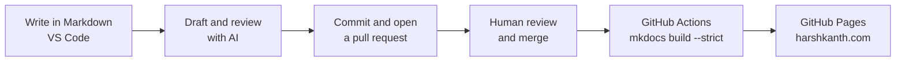

# How this site is built

<p class="lead">This portfolio is built the way I build documentation for clients: plain-text content in Git, an automated build that catches mistakes, and AI in the workflow with a human reviewing every change.</p>

<div class="facts">
  <div><span class="k">Content</span><span class="v">Markdown</span></div>
  <div><span class="k">Generator</span><span class="v">MkDocs with Material for MkDocs</span></div>
  <div><span class="k">Source</span><span class="v">Public GitHub repository</span></div>
  <div><span class="k">Publishing</span><span class="v">GitHub Actions to GitHub Pages</span></div>
  <div><span class="k">AI</span><span class="v">Claude, SAP Joule, AI steps in VS Code and GitHub</span></div>
</div>

## Why docs as code

Documentation that lives in the same tools as the product keeps up with the product. Writing in Markdown and managing it in Git gives documentation the same advantages code has:

- **Every change is tracked.** Git history shows what changed, when, and why.
- **Review happens in pull requests.** Engineers and product owners can comment on the exact line, or suggest a fix themselves.
- **The build checks the work.** A strict build fails on broken links, missing pages, and invalid configuration before anything is published.
- **Publishing is automatic.** Merging to the main branch is the release. Nobody uploads files by hand.

## The publishing pipeline



The deploy workflow is short enough to read in full:

```yaml title=".github/workflows/deploy.yml"
on:
  push:
    branches: [main]

jobs:
  deploy:
    runs-on: ubuntu-latest
    steps:
      - uses: actions/checkout@v4
      - uses: actions/setup-python@v5
        with:
          python-version: "3.12"
      - run: pip install -r requirements.txt
      - run: mkdocs build --strict
      - run: mkdocs gh-deploy --force
```

## How the repository is organized

```text title="harsh-kanth/"
├── mkdocs.yml              # site settings, navigation, theme
├── requirements.txt        # pinned MkDocs and Material versions
├── overrides/              # small template changes (sharing metadata)
├── .github/workflows/      # build and deploy on every merge
└── docs/
    ├── index.md            # home page
    ├── work/               # one Markdown file per case study
    ├── samples/            # complete writing samples
    ├── experience.md
    ├── services.md
    ├── docs-as-code.md     # this page
    └── assets/             # stylesheet, images, résumé
```

Adding a case study means adding one Markdown file and one line to `mkdocs.yml`. The structure is documented in the repository's README, so the site is as maintainable as the documentation I hand over to clients.

## AI in my workflow

I use AI every day, as a tool inside a process I control rather than a replacement for writing and verification.

<div class="grid cards three-up" markdown>

-   <span class="hk-slug">claude</span>

    **Drafting, restructuring, and review**

    First drafts from engineering notes, restructuring long topics, consistency and style checks across a doc set, and building and maintaining this site.

-   <span class="hk-slug">sap joule</span>

    **SAP work**

    SAP's AI copilot, used alongside SAP products in my SAP consulting and documentation work.

-   <span class="hk-slug">vs code + github</span>

    **AI pipelines**

    AI-assisted steps in the editor and in GitHub workflows, so checks and repetitive tasks run where the content lives.

-   <span class="hk-slug">me</span>

    **Verification and judgment**

    Every procedure is checked against the product, terminology is agreed with product owners, and nothing ships until I've reviewed it.

</div>

### The rules I follow

- **AI drafts; I decide.** Structure, terminology, and what goes into the final document are my decisions.
- **Verify against the source.** Steps, values, and claims are checked against the product or the subject matter expert, never taken on trust from a model.
- **Keep confidential content confidential.** Client material goes only into tools the client has approved.
- **Review every change.** AI-assisted edits go through the same pull request review as anything else.

## See it for yourself

[:fontawesome-brands-github: Browse the source on GitHub](https://github.com/harshkanth/harsh-kanth){ .md-button .md-button--primary }

Every page on this site has an **Edit this page** button that opens its Markdown source on GitHub.
