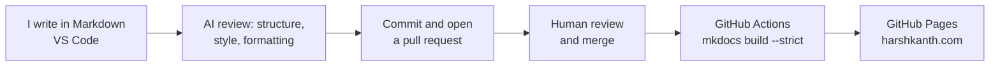

# How this site is built

<p class="lead">I wrote and built this portfolio myself, the same way I build documentation for clients: plain-text content in Git, an automated build that catches mistakes, and AI as a reviewer, not a writer.</p>

<div class="facts">
  <div><span class="k">Content</span><span class="v">Markdown</span></div>
  <div><span class="k">Generator</span><span class="v">MkDocs with Material for MkDocs</span></div>
  <div><span class="k">Source</span><span class="v">Public GitHub repository</span></div>
  <div><span class="k">Publishing</span><span class="v">GitHub Actions to GitHub Pages</span></div>
  <div><span class="k">AI</span><span class="v">Review, structure, and style checks</span></div>
</div>

## Why docs as code

Documentation that lives in the same tools as the product keeps up with the product. Writing in Markdown and managing it in Git gives documentation the same advantages code has:

- **Every change is tracked.** Git history shows what changed, when, and why.
- **Review happens in pull requests.** Engineers and product owners can comment on the exact line, or suggest a fix themselves.
- **The build checks the work.** A strict build fails on broken links, missing pages, and invalid configuration before anything is published.
- **Publishing is automatic.** Merging to the main branch is the release. Nobody uploads files by hand.

## The publishing pipeline



The deploy workflow is short enough to read in full:

```yaml title=".github/workflows/deploy.yml"
on:
  push:
    branches: [main]

jobs:
  deploy:
    runs-on: ubuntu-latest
    steps:
      - uses: actions/checkout@v4
      - uses: actions/setup-python@v5
        with:
          python-version: "3.12"
      - run: pip install -r requirements.txt
      - run: mkdocs build --strict
      - run: mkdocs gh-deploy --force
```

## How the repository is organized

```text title="harsh-kanth/"
├── mkdocs.yml              # site settings, navigation, theme
├── requirements.txt        # pinned MkDocs and Material versions
├── overrides/              # small template changes (sharing metadata)
├── .github/workflows/      # build and deploy on every merge
└── docs/
    ├── index.md            # home page
    ├── work/               # one Markdown file per case study
    ├── samples/            # complete writing samples
    ├── experience.md
    ├── services.md
    ├── docs-as-code.md     # this page
    └── assets/             # stylesheet, images, résumé
```

Adding a case study means adding one Markdown file and one line to `mkdocs.yml`. The structure is documented in the repository's README, so the site is as maintainable as the documentation I hand over to clients.

## How I use AI

I write the content myself. AI comes in afterwards, the way a second reviewer would: it checks what I've written and suggests improvements, and I decide what to accept.

<div class="grid cards three-up" markdown>

-   <span class="hk-slug">review</span>

    **Review and consistency**

    Checking drafts I've written for clarity, consistency, and terminology across pages, and catching what a tired second read would miss.

-   <span class="hk-slug">structure</span>

    **Structure and flow**

    Suggestions on how to order sections, split long topics, and make headings easier to scan.

-   <span class="hk-slug">style and format</span>

    **Style and formatting**

    Checks against style rules, plus Markdown formatting, tables, and code blocks, so the source stays clean.

-   <span class="hk-slug">tools</span>

    **What I use**

    Claude for review, Joule in my SAP work, and AI-assisted checks in VS Code and GitHub.

</div>

### My rules for AI

- **I write; AI reviews.** The content, the decisions, and the final wording are mine.
- **Suggestions, not changes.** I read every suggestion and accept only what makes the page better.
- **Facts come from the source.** Steps, values, and claims are checked against the product or the subject matter expert, never taken from a model.
- **Confidential stays confidential.** Client material goes only into tools the client has approved.

## See it for yourself

[:fontawesome-brands-github: Browse the source on GitHub](https://github.com/harshkanth/harsh-kanth){ .md-button .md-button--primary }

Every page on this site has an **Edit this page** button that opens its Markdown source on GitHub.
