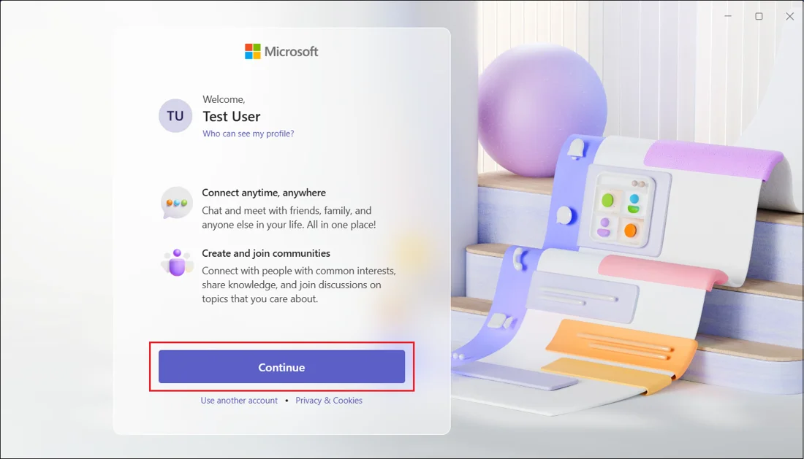

# Install Microsoft Teams

Install Microsoft Teams on your computer or phone and sign in, so you can chat, meet, and share files with your team.

!!! abstract "Writing sample"
    This guide was written as a portfolio sample and is not official Microsoft documentation. Product screens and options can change; for the latest details, see [Microsoft Support](https://support.microsoft.com/teams).

## Before you begin

Make sure you have the following:

- A device running a supported operating system: Windows 10 or 11, macOS, Android, or iOS
- A stable internet connection
- A Microsoft account, or a work or school account provided by your organization
- Permission to install apps on the device. On a work computer, your IT team may need to install Teams for you.

## Step 1: Download Teams

1. Go to the [Microsoft Teams download page](https://www.microsoft.com/microsoft-teams/download-app).
2. Select the download for your device.

    === "Windows"

        Select **Download for desktop**, and then select the Windows download.

    === "macOS"

        Select **Download for desktop**, and then select the macOS download.

    === "Android and iOS"

        Install **Microsoft Teams** from Google Play or the App Store, and then go to [Step 3](#step-3-sign-in).

## Step 2: Install Teams

=== "Windows"

    1. Open your **Downloads** folder and double-click the Teams installer.
    2. If Windows asks whether to allow the app to make changes, select **Yes**.
    3. Follow the on-screen instructions.

    When installation finishes, Teams opens automatically.

=== "macOS"

    1. Open your **Downloads** folder and double-click the Teams `.pkg` file.
    2. Follow the steps in the installer, and enter your Mac password if prompted.

    When installation finishes, Teams appears in your **Applications** folder.

## Step 3: Sign in

1. Open Teams.
2. Enter the email address for your Microsoft account or your work or school account, and then select **Next**.
3. Enter your password, and complete any additional verification your organization requires.
4. On the welcome screen, confirm your name and select **Continue**.

    { .screenshot loading=lazy width=640 }
    /// caption
    Confirm your account and select Continue.
    ///

**Result:** Teams opens to the **Chat** tab, and you're ready to start working.

## Step 4: Check your audio and notifications (recommended)

Take a minute to set up the basics before your first call.

1. Select **Settings and more** (**...**) next to your profile picture, and then select **Settings**.
2. Select **Devices**, choose your speaker, microphone, and camera, and then select **Make a test call**.
3. Select **Notifications and activity**, and choose how you want to be notified about chats, mentions, and meetings.

## Troubleshooting

??? question "Teams doesn't open after installation"
    Restart your device and open Teams again. On Windows, check that Teams isn't already running in the system tray, near the clock.

??? question "The installer won't run on my work computer"
    Your organization might restrict app installations. Contact your IT team, or use Teams in a browser at [teams.microsoft.com](https://teams.microsoft.com) in the meantime.

??? question "I can't sign in with my work account"
    Confirm that you're using the email address your organization gave you, and that your organization has Teams enabled. If you still can't sign in, contact your IT team.

## Next steps

- [Schedule a meeting in Microsoft Teams](schedule-teams-meeting.md)
