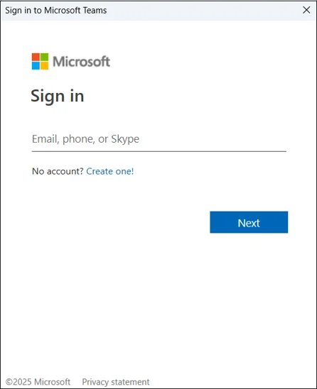

# Schedule a meeting in Microsoft Teams

Schedule a Teams meeting from your calendar, invite people inside or outside your organization, and control who can present and who waits in the lobby.

!!! abstract "Writing sample"
    This guide was written as a portfolio sample and is not official Microsoft documentation. Product screens and options can change; for the latest details, see [Microsoft Support](https://support.microsoft.com/teams).

**Who this is for:** anyone who needs to set up one-on-one meetings, team meetings, or meetings with external guests.

## Before you begin

- Install Teams, or open it in a browser at [teams.microsoft.com](https://teams.microsoft.com). For setup steps, see [Install Microsoft Teams](install-microsoft-teams.md).
- Use a work or school account. Your organization's settings control whether you can schedule meetings and invite external guests.

## Open Teams and sign in

1. Open the Teams app, or go to [teams.microsoft.com](https://teams.microsoft.com) in your browser.
2. Sign in with your work or school account.

    { .screenshot loading=lazy width=320 }

3. On the welcome screen, select **Continue**.

**Result:** Teams opens to the **Chat** tab.

## Create the meeting

1. In the left navigation, select **Calendar**.
2. In the top-right corner of the calendar, select **New meeting**.
3. Enter the meeting details:

    | Field | What to enter |
    |-------|---------------|
    | **Title** | A short, specific name, for example "Q3 roadmap review" |
    | **Required attendees** | Names or email addresses. Teams suggests people from your organization as you type. To invite someone outside your organization, enter their full email address. |
    | **Date and time** | The start and end times. Select **Scheduling Assistant** to see when attendees are free. |
    | **Location** | Leave blank for an online-only meeting, or add a room for a hybrid meeting. |
    | **Details** | The agenda, plus any documents or links people should review beforehand. |

4. Optional: to repeat the meeting, select **Does not repeat** and choose how often it should recur.

## Set meeting options (optional)

Meeting options control what happens when people join. You can set them now or any time before the meeting.

1. Save the meeting first, then open it from your calendar.
2. Select **Meeting options**.
3. Choose your settings, for example:
    - **Who can bypass the lobby**: decide who joins directly and who waits for you to admit them.
    - **Who can present**: limit presenting to you or to specific people.
    - **Allow mic and camera for attendees**: turn off for large broadcasts.
4. Select **Save**.

!!! tip
    For meetings with external guests, have them wait in the lobby and limit who can present. You can admit people and change roles during the meeting.

## Send the invitation

1. Review the details.
2. Select **Send**, or **Save** if you haven't invited anyone yet.

**Result:** attendees receive an invitation with the date, time, and a **Join** link. The meeting appears in your Teams calendar and in Outlook.

## Join or update the meeting

- **To join**, select the meeting in your calendar, and then select **Join**.
- **To change the meeting**, open it from your calendar, make your changes, and then select **Send update**. Attendees receive the updated invitation.

## Troubleshooting

??? question "I don't see New meeting in my calendar"
    Your organization might not allow you to schedule meetings. Contact your IT team.

??? question "External guests can't join"
    Your organization's settings might block external participants. Ask your IT team whether external access and anonymous join are allowed.

??? question "My meeting doesn't show up in Outlook"
    Make sure you're signed in to Teams and Outlook with the same work account, and that the Teams Meeting add-in is enabled in Outlook.

## Related

- [Install Microsoft Teams](install-microsoft-teams.md)
