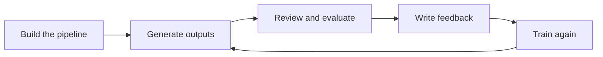

# AI training and evaluation

I help train AI models to write better technical content. I build pipelines, write and review outputs, evaluate them against documentation standards, and turn my findings into feedback that goes into the next round of training.

  
ProjectsUber, Outlier Project Aether, Mercor Project Odin

  
RolesWriter, reviewer, evaluator

  
FocusTechnical writing

  
StatusOngoing

## Why a technical writer

Models learn what good looks like from the people who judge their output. Judging technical writing well takes the same skills as writing it: knowing whether a procedure actually works, whether the structure fits the reader's task, and whether the terminology is consistent. That's ten years of documentation work applied to a new kind of reader.

## Projects

### Writer and reviewer · Mercor, Project Odin
Present

Writing content and reviewing outputs as part of Project Odin.

### AI training for technical writing · Uber
May 2026 – Jul 2026

- Created an AI pipeline for technical writing tasks
- Ran it to produce outputs, then reviewed and evaluated each one
- Wrote feedback on what worked and what didn't, and used it to train the model again
- Repeated the loop, so each round built on the last round's evaluation

### Contributor · Outlier, Project Aether
Mar 2026 – Apr 2026

Contributed to Project Aether on the Outlier platform.

## The loop I work in

## What this shows

- Applying documentation standards to evaluate machine-written content
- Writing feedback that is specific and consistent enough to train on
- Hands-on experience building and iterating on AI pipelines, the same skills I bring to AI-assisted documentation workflows

!!! info "Confidentiality"
    Details of these projects are covered by confidentiality agreements, so this page describes my role rather than the work itself.
